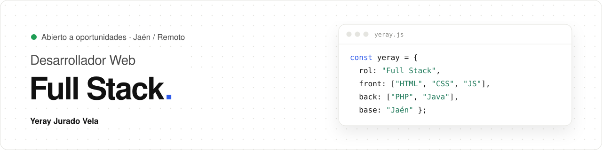

  

## 👋 Hola, soy Yeray

Socorrista en verano, árbitro los findes y programador el resto del tiempo. Sí, duermo poco 😅

- 🎓 Estudio 2.º de **Desarrollo de Aplicaciones Web** en el IES Las Fuentezuelas (Jaén)
- 💼 He pasado por el programa de formación de **NTT DATA**
- 🌐 Hago webs para pequeños negocios
- 📚 Ahora mismo aprendiendo **React** y **Angular**
- 📍 Jaén · abierto a trabajar en remoto

## 🛠️ Stack

  

**Herramientas:**

  

## 📊 Estadísticas

  
  

## 📫 Contacto

  

