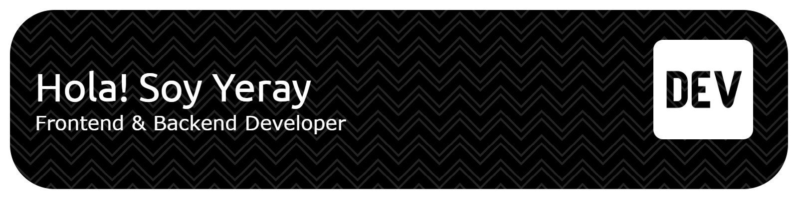

<!-- Banner (opcional): sube una imagen a tu repo y cambia la ruta -->

  

# 👋 ¡Hola! soy Yeray Jurado
✨ Estudiante de **1º de Desarrollo de Aplicaciones Web**  
💻 Apasionado por el desarrollo frontend y backend. Creo proyectos prácticos y aprendo cada día.

---

## 🧭 Lo que estudio (asignaturas actuales)
- **Programación**: fundamentos de JavaScript y lógica de programación  
- **Entornos de Desarrollo**: Git, GitHub, VS Code, terminal  
- **Bases de Datos**: MySQL y consultas SQL  
- **Lenguajes de Marcas**: HTML / CSS / XML  
- **Sistemas Informáticos y redes**: fundamentos de hardware, software y redes  

---

## 🛠️ Tecnologías y herramientas

---

## 📫 Contacto
- ✉️ correo: `yjuradovela@gmail.com`  
- 💼 LinkedIn: `https://www.linkedin.com/in/tu-perfil`  

---

⭐ Siempre aprendiendo y listo para colaborar.
